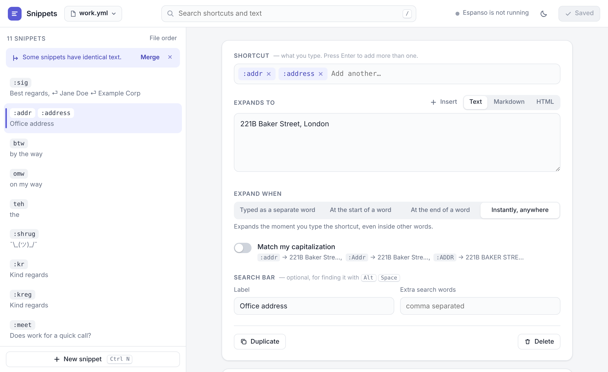

<p align="center">
  
</p>

<h1 align="center">Espanso Snippets Manager</h1>

<p align="center">
  A fast, friendly editor for your <a href="https://espanso.org">Espanso</a> snippets.<br>
  No more hand-editing YAML. Runs on your computer, works offline, nothing to sign up for.
</p>

<p align="center">
  <a href="https://github.com/gilikarn/Espanso-Snippets-Manager/actions/workflows/ci.yml"></a>
  <a href="https://github.com/gilikarn/Espanso-Snippets-Manager/releases/latest"></a>
  <a href="LICENSE"></a>
  
</p>

<picture>
  <source media="(prefers-color-scheme: dark)" srcset="docs/screenshot-dark.png">
  
</picture>

## Features

- **Everything in one place.** Searchable list of every snippet in your match folder, including subfolders.
- **Edit without YAML.** Shortcuts, replacement text, and the options people actually use, as plain controls:
  - several shortcuts for one snippet (`:addr` and `:address`)
  - when to expand: as a separate word, at the start or end of a word, or instantly
  - match your capitalization (`teh` → `the`, `Teh` → `The`)
  - plain text, Markdown or HTML (rich text)
  - label and extra search words for Espanso's search bar (<kbd>Alt</kbd>+<kbd>Space</kbd>)
- **Insert dynamic bits** with one click: where the cursor should end up, today's date or time in several formats, or the clipboard.
- **Try it box.** Type in a test box and see your snippets expand, including unsaved changes.
- **Safe saves.**
  - A backup of the previous version is kept on every save.
  - If a file was changed elsewhere, you're asked before anything is overwritten.
  - Anything the editor doesn't understand (regex triggers, forms, shell variables, comments at the top of a file) is kept as it is.
- **Tidy up.**
  - Warns about duplicate shortcuts, even across files.
  - Offers to merge snippets that have identical text.
  - Create new files, including in subfolders.
- **Keyboard friendly.** <kbd>/</kbd> search, <kbd>↑</kbd> <kbd>↓</kbd> move, <kbd>Ctrl</kbd>/<kbd>⌘</kbd>+<kbd>S</kbd> save, <kbd>Ctrl</kbd>/<kbd>⌘</kbd>+<kbd>N</kbd> new snippet.
- **Light and dark mode**, following your system.

Espanso reloads your files automatically, so changes are live a moment after you save.

## Install

You need [Espanso](https://espanso.org/install/) installed. On macOS and Linux you also need Python 3.8 or later, which most systems already have.

### Windows

Open **PowerShell** and run:

```powershell
irm https://raw.githubusercontent.com/gilikarn/Espanso-Snippets-Manager/main/install/install.ps1 | iex
```

This adds an **Espanso Snippets** shortcut to the Start menu and the desktop. It installs for your user only, so you don't need admin rights. Nothing besides the built-in Windows PowerShell is required.

### macOS and Linux

```sh
curl -fsSL https://raw.githubusercontent.com/gilikarn/Espanso-Snippets-Manager/main/install/install.sh | sh
```

What it adds:
- **macOS:** an **Espanso Snippets** app in the Applications folder inside your home folder (find it with Spotlight).
- **Linux:** an entry in your app menu, plus an `espanso-snippets-manager` command.

### Manual install

1. Download `espanso-snippets-manager.zip` from the [latest release](https://github.com/gilikarn/Espanso-Snippets-Manager/releases/latest).
2. Extract it.
3. Run `install.ps1` (Windows: right-click → *Run with PowerShell*) or `./install.sh` (macOS/Linux).

### Run without installing

```sh
# Windows
powershell -ExecutionPolicy Bypass -File server.ps1
# macOS / Linux
python3 server.py
```

Run these from the extracted release folder.

## Using it

Open **Espanso Snippets**. It opens in its own window: an app-style window if you have Edge, Chrome, Brave or Chromium, otherwise a regular browser tab.

- Pick a file at the top left. Your files are listed from Espanso's `match` folder.
- Click a snippet to edit it. Press <kbd>Ctrl</kbd>/<kbd>⌘</kbd>+<kbd>S</kbd> to save.
- Closing the window stops the app.

### Where things are

| | Windows | macOS | Linux |
|---|---|---|---|
| Your snippets (Espanso's folder) | `%APPDATA%\espanso\match` | `~/Library/Application Support/espanso/match` | `~/.config/espanso/match` |
| App | `%LOCALAPPDATA%\Programs\Espanso Snippets Manager` | `~/Applications/Espanso Snippets.app` | `~/.local/share/espanso-snippets-manager` |
| Backups (last 30 per file) | `%LOCALAPPDATA%\Espanso Snippets Manager\backups` | `~/Library/Application Support/Espanso Snippets Manager/backups` | `~/.local/state/espanso-snippets-manager/backups` |

The app asks Espanso where its config folder is (`espanso path config`), so a custom or synced location is picked up automatically. To point the app somewhere else, use either option:

- set the `ESPANSO_CONFIG_DIR` environment variable, or
- pass `--config-dir` (Python) / `-ConfigDir` (PowerShell).

Use `--print-config` / `-PrintConfig` to see which folders it will use.

### Good to know

- **Comments.**
  - Comments at the top of a file are kept.
  - Comments between snippets can't survive a rewrite, so the app warns you before the first save of such a file. A backup is kept either way.
- **Packages** installed with `espanso install` live in `match/packages` and are managed by Espanso, so they're not shown.
- **Files starting with `_`** aren't loaded by Espanso automatically. The app shows them, with a note.
- **Advanced snippets** (regex triggers, forms, image snippets) are shown read-only and saved exactly as they were.

## Uninstall

- **Windows:** Settings → Apps → *Espanso Snippets Manager* → Uninstall, or run `uninstall.ps1` from the app folder.
- **Linux:** `sh ~/.local/share/espanso-snippets-manager/uninstall.sh`
- **macOS:** `sh ~/Applications/Espanso\ Snippets.app/Contents/Resources/uninstall.sh`

Your Espanso snippets are never touched. Backups are kept unless you pass `-RemoveBackups` / `--remove-backups`.

## How it works

The editor is a single web page. A tiny helper serves it and reads and writes the files in your match folder:
- **Windows:** `server.ps1`, built-in PowerShell.
- **macOS and Linux:** `server.py`, standard-library Python.

The helper:

- listens on `localhost` only (port 47811, or the next free one) and answers only requests addressed to it;
- only reads and writes `.yml`/`.yaml` files inside the match folder;
- writes each file atomically and keeps a backup first;
- makes no network requests, collects no telemetry, and stops when you close the window (or after 8 idle hours).

See [SECURITY.md](SECURITY.md) for details.

## Development

```sh
npm install              # dev tools: js-yaml (bundled into the page) and Playwright
npm run build            # -> dist/espanso-snippets-manager/
npm start                # build and run against your real Espanso folder
npm test                 # helper tests + end-to-end browser tests
npm run package          # release archives in dist/
```

The UI lives in [`src/index.html`](src/index.html), with no framework and no build step beyond inlining js-yaml. The helpers are [`src/server.ps1`](src/server.ps1) and [`src/server.py`](src/server.py), and they implement the same small API. Test against the sample files in `tests/fixtures` with `python3 src/server.py --config-dir tests/fixtures/espanso` (after `npm run build`, use the copy in `dist/`).

Contributions are welcome. See [CONTRIBUTING.md](CONTRIBUTING.md). Looking for a place to start? Try an issue labelled [good first issue](https://github.com/gilikarn/Espanso-Snippets-Manager/labels/good%20first%20issue).

## Getting help

- **Questions and ideas:** [Discussions](https://github.com/gilikarn/Espanso-Snippets-Manager/discussions)
- **Bugs:** [Issues](https://github.com/gilikarn/Espanso-Snippets-Manager/issues/new/choose)
- **Security problems:** please report privately, see [SECURITY.md](SECURITY.md)

This is a spare-time project. Issues and pull requests are read and answered, but sometimes not quickly. Thanks for your patience!

## License

[MIT](LICENSE). Bundles [js-yaml](https://github.com/nodeca/js-yaml) (MIT).

Espanso Snippets Manager is an independent community project and is not affiliated with or endorsed by the Espanso project.
